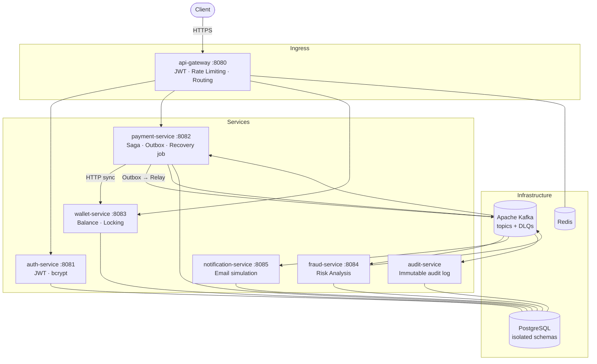
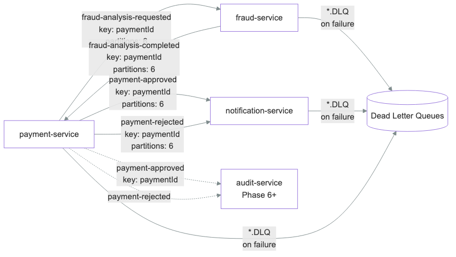
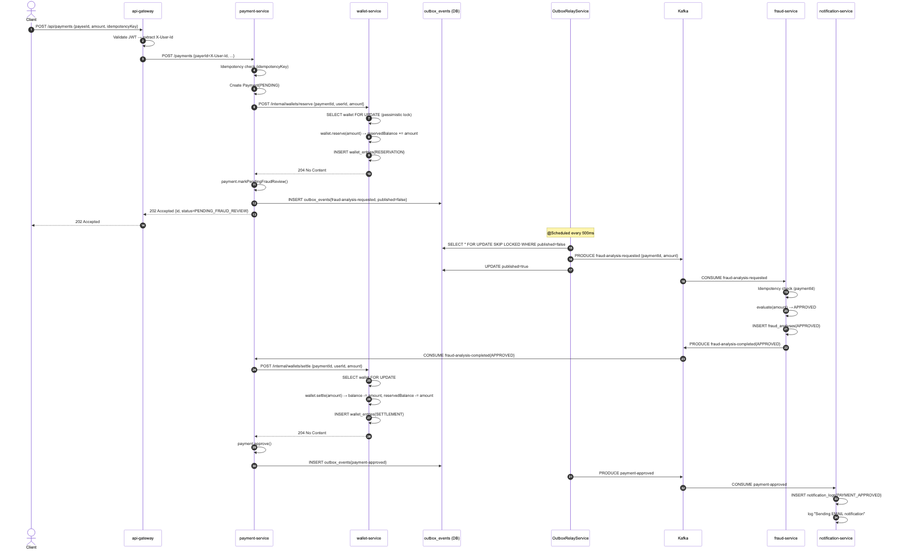

# PayStream

An event-driven payment backend built to practice and verify distributed-systems patterns: Saga, Transactional Outbox, idempotency, pessimistic locking and resilient Kafka consumers. Java 21, Spring Boot 3, Kafka, PostgreSQL, Redis, 7 microservices.

Every guarantee claimed below is backed by a test or a measurement in [docs/VERIFICATION.md](docs/VERIFICATION.md).

---

## Results

Measured on a laptop (Intel i5-1155G7, 4 cores) with the **entire stack and the load generator running in Docker on the same machine**. Treat them as laptop numbers; the behaviour and the before/after comparison are the point.

| Check | Result |
|---|---|
| 100 simultaneous requests, same idempotency key | 1 payment created, payer debited once |
| 200 concurrent payments from a wallet funded for 100 | Exactly 100 approved, 100 rejected, 0 server errors, money conserved |
| Wallet-service outage during payment creation | Payment accepted as `PENDING`, completed automatically by the recovery job, 0 funds left reserved |
| Load test at 20 payments/s, 1 consumer thread | p95 29.2 s (307 payments unfinished after 30 s) |
| Load test at 20 payments/s, 6 consumer threads | p95 1.74 s |
| Reconciliation after ~10,000 payments | 0 stuck, 0 settled twice, 0 leaked reservations, 0 messages in DLQs |

Full tables, hardware, reproduction steps and known limitations: [docs/VERIFICATION.md](docs/VERIFICATION.md). Test code: [loadtest/](loadtest).

---

## Bugs found and fixed

**Reservation leak.** payment-service called wallet-service (a remote call that commits in another service's database) from inside its own DB transaction. A crash or outage in between could leave funds reserved with no matching payment. Fix: payment creation is split into durable steps (record `PENDING`, reserve funds outside any transaction, then advance state and write the outbox event atomically), and a recovery job re-drives stuck payments. Wallet reservations are idempotent per `paymentId`, so retries are safe.

**Consumer bottleneck.** Topics had 6 partitions, but the Kafka listeners ran with the default concurrency of 1, so one thread processed every partition sequentially (each fraud result triggers a synchronous wallet settle call). At 20 payments/s, latency collapsed. Concurrency is now configurable (`APP_KAFKA_CONCURRENCY`, default 6), matching the partition count.

---

## Architecture



---

## Implemented Patterns

| Pattern | Where | Guarantee |
|---|---|---|
| **Choreography Saga** | payment → wallet → fraud → notification | Distributed transaction without 2PC |
| **Transactional Outbox** | payment-service | Atomic DB write + Kafka publish, no dual-write risk |
| **Forward recovery job** | payment-service | Payments stuck in `PENDING` are re-driven (payments older than 30 s, every 15 s) |
| **Pessimistic Locking** | wallet-service | `SELECT FOR UPDATE` prevents race conditions on balance |
| **Idempotency Keys** | payment-service (HTTP), wallet-service (reserve/settle/release) | Safe retries without double-charges |
| **Idempotent consumers** | fraud-service, wallet-service | Redelivered Kafka messages are not applied twice |
| **Dead Letter Queue** | All Kafka consumers | Failed messages preserved for ops inspection |
| **Exponential backoff** | All Kafka consumers | 1s → 2s → 4s before DLQ |
| **JWT Authentication** | api-gateway (validation) + auth-service (issuance) | Stateless auth, 15m access / 7d refresh |
| **Rate Limiting** | api-gateway + Redis | Token bucket per client |
| **Distributed Tracing** | All services | W3C trace context, Micrometer (Brave) → Zipkin |
| **Structured Logging** | All services | JSON via logstash-logback-encoder, traceId in every line |

---

## Tech Stack

| Layer | Technology |
|---|---|
| Language | Java 21 |
| Framework | Spring Boot 3.4, Spring Cloud 2024 |
| Gateway | Spring Cloud Gateway (reactive) |
| Security | Spring Security 6, JJWT 0.12 |
| Messaging | Apache Kafka (Confluent Platform 7.7) |
| Database | PostgreSQL 16 |
| Cache / rate limiting | Redis 7 |
| Build | Gradle 8 (Kotlin DSL, version catalog) |
| Observability | Micrometer Tracing (Brave), Prometheus, Grafana, Zipkin |
| API Docs | SpringDoc OpenAPI 2.7 (Swagger UI) |
| Testing | JUnit 5, Mockito, Testcontainers, k6 |
| CI/CD | GitHub Actions |
| Infrastructure | Docker, Docker Compose |

---

## Services

| Service | Port | Swagger UI | Description |
|---|---|---|---|
| api-gateway | 8080 | — | Ingress: JWT validation, rate limiting, routing |
| auth-service | 8081 | `/swagger-ui.html` | User registration, login, JWT + refresh token lifecycle |
| payment-service | 8082 | `/swagger-ui.html` | Payment creation, saga state, Transactional Outbox, recovery job |
| wallet-service | 8083 | `/swagger-ui.html` | Balance reservation, settlement, pessimistic locking |
| fraud-service | 8084 | — | Asynchronous risk analysis via Kafka |
| notification-service | 8085 | — | Email notification simulation |
| audit-service | 8086 | — | Immutable audit log of payment events |

---

## Kafka Topics



| Topic | Partitions | Producer | Consumers |
|---|---|---|---|
| `fraud-analysis-requested` | 6 | payment-service | fraud-service |
| `fraud-analysis-completed` | 6 | fraud-service | payment-service |
| `payment-approved` | 6 | payment-service | notification-service |
| `payment-rejected` | 6 | payment-service | notification-service |
| `*.DLQ` | 1 | consumers (on failure) | ops alerting |

Partition key: `paymentId`, which guarantees ordering for all events of the same payment. Consumer concurrency matches the partition count (6).

---

## Payment Flow



```
1.  POST /api/auth/login                 → access_token (JWT, 15m TTL)
2.  POST /api/payments  {idempotencyKey} → payment saved as PENDING (duplicate key → same payment, 409 if the amount differs)
3.  payment-service calls wallet-service → reserve funds (outside any DB transaction, idempotent per paymentId)
4.  payment-service advances the payment → PENDING_FRAUD_REVIEW + outbox event, atomic in one transaction → 202
5.  OutboxRelayService publishes         → fraud-analysis-requested (Kafka)
6.  fraud-service analyzes               → amount > 50,000 BRL → REJECTED
7.  payment-service receives result      → settle or release the wallet reservation
8.  payment-service writes approved/rejected to the outbox
9.  notification-service consumes        → email simulation

If wallet-service is down at step 3, the payment stays PENDING and the recovery job completes it once the wallet is back.
```

---

## Quick Start

### Prerequisites
- JDK 21, Docker 24+, Docker Compose v2

```bash
# Build the service jars (the Dockerfiles package the pre-built jars)
./gradlew bootJar

# Start infrastructure + all services
cd infra/docker
docker compose up -d --build
# after code changes: ./gradlew bootJar, then docker compose up -d --build --force-recreate

# Start observability stack (Prometheus, Grafana, Zipkin)
docker compose -f docker-compose.monitoring.yml up -d
```

### Try the flow

```bash
# 1. Register
curl -X POST http://localhost:8080/api/auth/register \
  -H "Content-Type: application/json" \
  -d '{"email":"user@example.com","password":"Password123!"}'

# 2. Login → get token
TOKEN=$(curl -s -X POST http://localhost:8080/api/auth/login \
  -H "Content-Type: application/json" \
  -d '{"email":"user@example.com","password":"Password123!"}' | jq -r .accessToken)

# 3. Create wallet (userId = the id of the user you registered)
curl -X POST http://localhost:8080/api/wallets \
  -H "Authorization: Bearer $TOKEN" \
  -H "Content-Type: application/json" \
  -d '{"userId":"<your-user-id>","initialBalance":5000,"currency":"BRL"}'

# 4. Create payment (async: fraud analysis runs via Kafka)
curl -X POST http://localhost:8080/api/payments \
  -H "Authorization: Bearer $TOKEN" \
  -H "Content-Type: application/json" \
  -d '{"payeeId":"<payee-user-id>","amount":500,"currency":"BRL","idempotencyKey":"pay-001"}'

# 5. Poll until APPROVED
curl http://localhost:8080/api/payments/<payment-id> -H "Authorization: Bearer $TOKEN"
```

The scripted versions of these flows, including the concurrency and outage tests, are in [loadtest/](loadtest).

### Monitoring

| Tool | URL | Credentials |
|---|---|---|
| Grafana | http://localhost:3000 | admin / admin |
| Prometheus | http://localhost:9090 | — |
| Zipkin | http://localhost:9411 | — |
| Kafka UI | http://localhost:8090 | — |
| Swagger (auth) | http://localhost:8081/swagger-ui.html | — |
| Swagger (payment) | http://localhost:8082/swagger-ui.html | — |
| Swagger (wallet) | http://localhost:8083/swagger-ui.html | — |

---

## Local Development (without Docker)

```bash
# Start infrastructure only
cd infra/docker
docker compose up -d postgres redis kafka zookeeper kafka-init

# Run any service
./gradlew :auth-service:bootRun
./gradlew :payment-service:bootRun
```

---

## Project Structure

```
PayStream/
├── .github/workflows/ci.yml           # GitHub Actions: build + test on every push
├── api-gateway/                       # Spring Cloud Gateway, JWT filter, Redis rate limiting
├── auth-service/                      # JWT auth, refresh tokens
├── payment-service/                   # Saga state, Transactional Outbox, recovery job
├── wallet-service/                    # Pessimistic locking, idempotent operations
├── fraud-service/                     # Kafka-only, risk rules
├── notification-service/              # Kafka-only, email simulation
├── audit-service/                     # Immutable audit log
├── shared-libs/
│   ├── common-domain/                 # AggregateRoot, DomainEvent, base exceptions
│   └── common-events/                 # Kafka event records shared by producers/consumers
├── infra/                             # Docker Compose, monitoring config, Kubernetes manifests
├── loadtest/                          # correctness_test.py, recovery_demo.py, k6/load_test.js
└── docs/
    ├── adr/                           # ADR-001 through ADR-005
    ├── images/                        # Architecture, sequence and Kafka diagrams
    └── VERIFICATION.md                # Test and load-test results
```

---

## Diagrams

| Diagram | File |
|---|---|
| System Architecture | [docs/images/readme-architecture.png](docs/images/readme-architecture.png) |
| Payment Sequence (happy path) | [docs/images/payment-happy-path.png](docs/images/payment-happy-path.png) |
| Payment Rejection | [docs/images/payment-rejection.png](docs/images/payment-rejection.png) |
| Kafka Event Flow | [docs/images/kafka-topics.png](docs/images/kafka-topics.png) |

---

## Architecture Decisions

| # | Decision | Rationale |
|---|---|---|
| [ADR-001](docs/adr/ADR-001-microservices-architecture.md) | Microservices | Independent scaling, fault isolation, team autonomy |
| [ADR-002](docs/adr/ADR-002-kafka-event-driven-communication.md) | Kafka messaging | Durable, replayable, decoupled async communication |
| [ADR-003](docs/adr/ADR-003-saga-pattern.md) | Choreography Saga | No central orchestrator, services remain autonomous |
| [ADR-004](docs/adr/ADR-004-outbox-pattern.md) | Transactional Outbox | Atomic DB write + event publish, no dual-write risk |
| [ADR-005](docs/adr/ADR-005-observability-stack.md) | Micrometer + Zipkin + Grafana | Unified tracing/metrics with minimal config overhead |

---

## Trade-offs & Design Decisions

**At-least-once delivery:** Kafka guarantees at-least-once. Every consumer implements idempotency: fraud-service checks `findByPaymentId`, wallet-service checks `existsByPaymentIdAndType` before applying mutations.

**Eventual consistency:** a payment is `PENDING_FRAUD_REVIEW` for roughly a second after creation. `GET /payments/{id}` may return a non-final state briefly before the fraud pipeline completes.

**Synchronous wallet calls, with forward recovery:** wallet-service is called synchronously from payment-service to reserve balance, but outside any DB transaction, because that call commits in another service's database and cannot be rolled back with ours. The payment is recorded as `PENDING` first; if wallet-service is down or payment-service crashes mid-flow, the payment stays `PENDING` and a recovery job re-drives it (wallet reservations are idempotent per `paymentId`), so funds are never reserved without a payment record. The trade-off: during a wallet outage, payments are accepted as `PENDING` and completed later instead of failing fast.

**Single PostgreSQL instance, multiple schemas:** schema isolation (not database isolation) is used here. At higher scale, each service would get its own PostgreSQL cluster with connection pooling (PgBouncer).

**Fraud threshold is static:** the fraud engine uses a fixed threshold (50,000 BRL). A production version would use a configurable rule engine or ML model; the interface (`FraudAnalysisService.evaluate()`) is designed for that extension.

---

## Scalability Considerations

- **Horizontal scaling:** services are stateless; scale by adding container replicas.
- **Kafka partitioning:** 6 partitions per topic supports 6 concurrent consumers per group, and listener concurrency is set to match. Increase partitions before scaling consumers past 6.
- **Outbox relay:** multiple relay instances are safe because of `SELECT FOR UPDATE SKIP LOCKED`; each instance claims a disjoint batch. The relay polls every 500 ms, which sets the latency floor of about 0.5 s end to end.
- **Wallet locking:** pessimistic write locks serialize writes per wallet. Concurrent payments from one wallet queue behind each other, which is the price of never overspending.

---

## Security Considerations

- JWT access tokens expire in 15 minutes; refresh tokens in 7 days
- Refresh tokens are stored as SHA-256 hashes; raw tokens are never persisted
- The API gateway strips all inbound `X-User-*` headers before routing, which prevents header injection
- BCrypt cost factor 10 for password hashing
- Schema-level DB isolation prevents cross-service data access

---

## CI/CD

GitHub Actions runs on every push:
1. Sets up JDK 21 (Temurin) and Gradle 8.11.1
2. Runs all unit and integration tests (`gradle test`)
3. Builds all service JARs (`gradle bootJar`)
4. Uploads test reports as artifacts (14-day retention)

